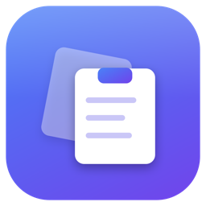

# ClipSync



Copy on one Mac. Paste on another. Directly over your local network.

ClipSync is a small menu bar app that keeps your clipboard in sync between Macs on the same Wi-Fi. No accounts, no cloud, no server. It finds your other Macs with Bonjour and exchanges clips over a direct TCP connection.

[](https://github.com/SrihariPHS/clipsync/actions/workflows/ci.yml)
[](LICENSE)


## What you get

- Copy text or an image on one Mac, paste it on another.
- Live sync while both apps are on.
- A recent-clips list in the menu, including clips that arrived while you were away.
- Optional sync code so only your Macs can connect.
- Launch at login.
- Everything stays on your machines. History lives in `~/Library/Application Support/ClipSync`.

## Requirements

- Two or more Macs on macOS 13 Ventura or newer.
- All Macs on the same network. Guest Wi-Fi and networks with client isolation will block discovery.
- Xcode Command Line Tools to build: run `xcode-select --install` if needed.

## Install

```sh
git clone https://github.com/SrihariPHS/clipsync.git
cd clipsync
make install
```

`make install` builds a release app, copies it to `/Applications`, and opens it. The first launch opens the menu for you:

1. Click **Sync Clipboard**.
2. Allow local network access when macOS asks.
3. Do the same on your other Mac.
4. Copy something here, paste it there.

No pairing, no account, nothing else.

## How it works

```text
 Mac A                                              Mac B
┌───────────────────┐      Bonjour discovery     ┌───────────────────┐
│ menu bar app      │ ◄────────────────────────► │ menu bar app      │
│                   │                            │                   │
│ clipboard watcher │      direct TCP (LAN)      │ clipboard watcher │
│ recent clips      │ ◄────────────────────────► │ recent clips      │
└───────────────────┘                            └───────────────────┘
```

- Each app advertises `_clipsync._tcp` over Bonjour and listens on a random TCP port.
- Peers connect directly. If both Macs dial each other at the same time, they agree on one link and close the duplicate.
- A new local copy is broadcast to every connected peer.
- On connect, peers exchange a capped history, so a Mac that was asleep still has the latest clips. Its newest clip is applied locally when it is less than an hour old and newer than anything already here.
- Received clips are written to the pasteboard but not rebroadcast, so clips cannot loop.

## Menu

| Item | What it does |
| --- | --- |
| **Sync Clipboard** | Turns sync and the clipboard watcher on or off. The state is remembered. |
| **Copy Received Clips Automatically** | Places a clip from another Mac on your clipboard as soon as it arrives. On by default. |
| **Recent Clips** | Click any of the last 8 clips to copy it again. Hover for origin and timestamp. |
| **Clear History…** | Deletes the local ClipSync history. Does not touch the current clipboard. |
| **Devices** | Shows connected Macs. |
| **Set Sync Code…** | Optional shared code. Every Mac must use the same one. |
| **Launch at Login** | Starts ClipSync when you log in. Requires the app in `/Applications`. |
| **About ClipSync** | Version, this Mac's name, and the GitHub link. |

## First-run and network permission

macOS asks for Local Network access the first time you turn sync on. Click **Allow**. Without it, ClipSync cannot see other Macs.

If you dismissed the prompt, enable ClipSync here and relaunch the app:

**System Settings → Privacy & Security → Local Network → ClipSync**

If the macOS firewall is on, allow incoming connections for ClipSync when prompted. You can also check **System Settings → Network → Firewall → Options**.

## Troubleshooting

**No other Macs show up**

- Both apps must have **Sync Clipboard** checked.
- Both Macs must be on the same network. Guest Wi-Fi, VLANs, and some mesh systems isolate clients from each other.
- Check Local Network permission (above).
- If you set a sync code, it must match exactly. Codes are case-insensitive and ignore surrounding spaces.
- Quit both apps, reopen, and toggle sync off and on.
- Look at the log:

  ```sh
  log stream --predicate 'subsystem == "com.srihariphs.clipsync"' --level info
  ```

**A clip arrives but does not paste**

ClipSync writes received clips to the system pasteboard. Some apps keep their own internal clipboard; use the app's normal Paste command, or click the clip in **Recent Clips** to put it on the pasteboard again.

**Launch at Login does not stick**

Move the app to `/Applications` (`make install` does this), try again, and approve it in **System Settings → General → Login Items**.

**Reset everything**

```sh
osascript -e 'quit app "ClipSync"'
launchctl bootout gui/$(id -u)/com.srihariphs.clipsync 2>/dev/null || true
rm -f ~/Library/LaunchAgents/com.srihariphs.clipsync.plist
rm -rf ~/Library/Application\ Support/ClipSync
defaults delete com.srihariphs.clipsync
```

Removing the app is enough to stop syncing. The reset block above also removes stored history and settings.

## Limits

- Text up to 256 KB and PNG images up to 8 MB. Files, PDFs, and rich text are not synced yet.
- History keeps 60 clips and at most 12 images.
- Only copies made while sync is on are captured.
- Same local network only. There is no relay over the internet.
- Clips are sent as plain TCP on your LAN. The sync code authenticates peers but does not encrypt traffic. Use ClipSync on networks you trust.

## Privacy and security

ClipSync does not have a server, an account, or telemetry. Clips are written only to the local Application Support folder and the system pasteboard.

Clips marked with the standard `org.nspasteboard.ConcealedType` or `org.nspasteboard.TransientType` are skipped, which keeps most password-manager copies out of history and off the wire. That is a convention, not a guarantee.

Anyone who can run a compatible client on your network can receive clips if no sync code is set. Set a code if other people share your Wi-Fi. The code is not encryption, so do not treat ClipSync as a secure channel for secrets.

## Development

```sh
make build      # release .app in build/
make debug      # debug .app in build/
make run        # build and open
make test       # unit tests
make self-test  # loopback TCP framing + envelope test
make icon       # regenerate Resources/AppIcon.icns
```

The package has no third-party dependencies. `ClipSyncCore` contains the wire format, framing, and merge rules, and is covered by tests. The executable target contains the AppKit menu bar app and the Network.framework transport.

```text
Sources/
  ClipSyncCore/     Clip model, envelope, frame codec, merge rules
  ClipSync/         Menu bar app, clipboard watcher, history, Bonjour + TCP
Tests/
  ClipSyncCoreTests/
Resources/
  Info.plist        LSUIElement, Bonjour service declaration
  AppIcon.icns
scripts/
  build-app.sh      Swift build + .app bundle + ad-hoc signature
  make-icon.sh
```

## License

MIT. See [LICENSE](LICENSE).
